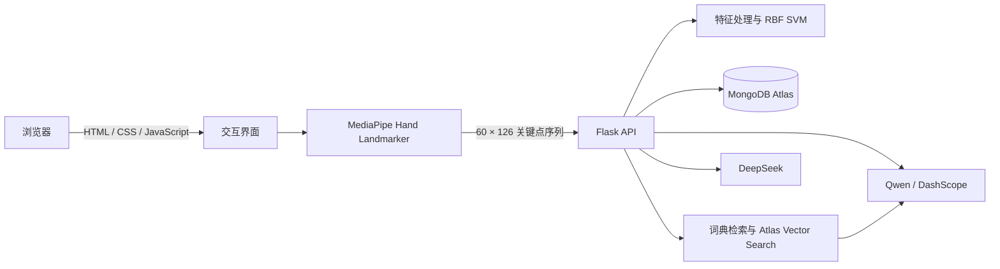

# 聆光手语多模态无障碍沟通平台

聆光手语是面向日常沟通与手语学习场景的 Web 应用。项目以浏览器端手部关键点识别为视觉入口，将固定词表手语识别、手语示范视频查询、词典知识检索、语音转写、AI 沟通建议和个性化学习组织在同一平台中。

本项目当前是**限定十类孤立词**的竞赛原型，不是通用手语翻译系统，也不把逐词识别结果包装成自然手语句子。

## 项目信息

| 条目 | 内容 |
| --- | --- |
| 项目名称 | 聆光手语多模态无障碍沟通平台 |
| 所属学校 | 哈尔滨学院 |
| 参赛成员 | 候甜甜、杨俊峰、柴铁航 |
| 指导教师 | 马立和、刘琳 |
| 代码托管 | [GitHub - Tiana771/LingGuangLanguage_1.1](https://github.com/Tiana771/LingGuangLanguage_1.1) |
| 当前分支 | `main` |

> 赛事要求仓库为 Public，或向评审提供可访问权限。提交前请在 GitHub 页面确认仓库可见性，并保留现有提交历史。

## 功能概览

- **手语识别**：浏览器通过 MediaPipe Hand Landmarker 提取双手 21 个关键点，组成 `60 × 126` 序列，由 Flask 服务端计算 252 维均值与标准差特征并执行 RBF SVM 分类。
- **选择性输出**：有效帧门控、置信度阈值和连续窗口投票共同决定是否显示识别结果；输入不足或置信度低时返回明确提示。
- **手语视频查询**：按词条或别名匹配本地词条，资源存在且状态为 `ready` 时播放示范视频。
- **词典知识检索**：支持词条精确匹配、关键词匹配和 Atlas Vector Search 语义召回，结果附带原文、册号、页码或 EPUB 锚点及原书图片。
- **沟通助手**：使用浏览器语音识别生成可编辑文字，通过 DeepSeek 生成重点摘要与回复建议，采用 SSE 流式返回。
- **个性化学习**：支持收藏、词单、今日计划、复习反馈和学习统计。
- **账号与隐私**：沟通记录、历史问答和学习数据按账号隔离；密码使用安全哈希，写接口校验 CSRF，外部服务密钥只保存在服务端。

## 技术架构



### 分层说明

| 层次 | 主要技术 | 职责 |
| --- | --- | --- |
| 前端 | HTML、CSS、原生 JavaScript、ES Modules | 页面、摄像头、语音、状态反馈与 SSE 消费 |
| 视觉 | `@mediapipe/tasks-vision` 1.1.1 | 双手关键点检测、手性和跟踪 |
| 推理 | NumPy、scikit-learn、joblib | 252 维特征、标准化、RBF SVM 与拒识 |
| 服务 | Flask 3.1.3 | 静态资源、账号、业务 API、模型推理和外部服务代理 |
| 数据 | MongoDB Atlas、PyMongo | 账号、会话、沟通记录、学习数据与词典知识 |
| 检索与生成 | Qwen、Atlas Vector Search、DeepSeek | 文本向量、证据约束回答、摘要和回复建议 |
| 部署 | Gunicorn、Caddy、systemd | 应用进程、HTTPS、反向代理与开机守护 |

## 目录结构

```text
.
├─ assets/                      # MediaPipe 模型和界面 SVG 资源
├─ book_media/                  # 词典原文图片（本地生成，Git 忽略）
├─ config/
│  └─ rejection_profiles.json  # 模型路径、拒识阈值与质量门限
├─ data/
│  └─ sign-entries.json        # 词条、别名与视频状态（需随作品包提供）
├─ deploy/                      # Caddy、systemd 与远程检查配置
├─ model_output/                # 训练结果与模型工件（Git 忽略）
├─ videos/                      # 十条手语示范视频
├─ index.html                   # 单页应用入口
├─ styles.css                   # 页面样式
├─ app.js                       # 前端业务与页面状态
├─ camera_features.mjs          # 浏览器端特征处理
├─ serve_sign_api.py            # Flask 应用与 API
├─ sign_features.py             # Python 端特征处理
├─ sign_baseline.py             # 模型推理契约
├─ mongo_store.py               # Atlas 数据访问与会话存储
├─ book_knowledge.py            # PDF/EPUB 词典解析
├─ import_sign_books.py         # 全量词典导入与审核
├─ phase2_train.py              # 252 维特征模型训练与评估
├─ train_multisigner.py         # 多录制者实验
├─ requirements.txt             # Python 依赖清单
└─ package.json                 # 浏览器视觉依赖清单
```

## 环境要求

项目已在以下环境完成开发与测试：

| 组件 | 已验证版本或要求 |
| --- | --- |
| 操作系统 | Windows 10/11；服务器使用 Ubuntu |
| Python | 3.9.12；建议 Python 3.9，避免 MediaPipe 与 NumPy 的版本兼容问题 |
| Node.js | 18.17.1；建议 Node.js 18 或更高版本 |
| 浏览器 | Chrome / Edge，需支持摄像头、Web Speech API 和 ES Modules |
| 数据库 | MongoDB Atlas；账号、沟通、学习和词典功能需要 |
| HTTPS | 公网摄像头功能必须部署在 HTTPS；本地使用 `localhost` |

### Python 依赖

完整版本固定于 [`requirements.txt`](requirements.txt)：

```text
Flask==3.1.3
scikit-learn==1.6.1
numpy==1.26.4
scipy==1.13.1
joblib==1.5.3
pymongo[srv]==4.18.3
python-dotenv>=1.0,<2
certifi>=2024.2.2
PyMuPDF>=1.24,<2
mediapipe==0.10.9
opencv-python==4.9.0.80
```

### 前端依赖

完整版本固定于 [`package-lock.json`](package-lock.json)：

```text
@mediapipe/tasks-vision 1.1.1
```

前端不经过 Vite 或 Webpack 构建。`npm install` 的主要作用是安装浏览器端 MediaPipe；Flask 直接提供页面、脚本、模型、WASM 和视频资源。

## 环境变量模板

在项目根目录复制模板：

```powershell
Copy-Item .env.example .env
```

`.env` 已被 `.gitignore` 排除，禁止提交真实密钥、数据库密码或服务器配置。

```dotenv
# MongoDB Atlas
MONGO_URI=mongodb+srv://<username>:<password>@<cluster-host>/<database>?retryWrites=true&w=majority
# 连接串已包含数据库名时可留空
MONGODB_DATABASE=
MONGODB_TLS_CA_FILE=
# 仅限本机临时排障，生产环境必须为 false
MONGODB_TLS_ALLOW_INVALID_CERTIFICATES=false

# Flask 服务端会话
FLASK_SECRET_KEY=replace-with-a-long-random-string
# 本地 HTTP 为 false，公网 HTTPS 部署必须为 true
FLASK_COOKIE_SECURE=false

# DeepSeek：摘要、回复建议和历史问答
DEEP_SEEK_API_KEY=
DEEP_SEEK_BASE_URL=https://api.deepseek.com
DEEP_SEEK_MODEL=deepseek-chat

# Qwen / DashScope
DASHSCOPE_API_KEY=
# 可覆盖 DashScope Key；不填时使用 DASHSCOPE_API_KEY
QWEN_API_KEY=
BOOK_QWEN_BASE_URL=https://cn-beijing.maas.qianwenaiapi.com/compatible-mode/v1
BOOK_QWEN_MODEL=qwen3.8-flash

# 文本 Embedding
BOOK_EMBEDDING_BASE_URL=https://cn-beijing.maas.qianwenaiapi.com/api/v1
BOOK_EMBEDDING_API_STYLE=native
BOOK_EMBEDDING_MODEL=qwen3.7-text-embedding-flash

# 词典知识集合与向量索引
BOOK_KNOWLEDGE_COLLECTION=SignKnowledgeChunks_v2
BOOK_EMBEDDING_INDEX_NAME=sign_knowledge_vector_v2
BOOK_SIMILARITY_MIN_SCORE=0.62

# 是否允许把词典原文发送至外部模型；需确认书籍授权
BOOK_CONTENT_EXTERNAL_ALLOWED=false

# 模型与拒识配置
SIGN_REJECTION_CONFIG=config/rejection_profiles.json
SIGN_REJECTION_MODE=calibrated
```

导入词典时另需显式确认：

```dotenv
BOOK_CONTENT_ATLAS_ALLOWED=true
```

该变量只用于导入器，不建议长期保留在 Web 服务环境中。

### 环境变量说明

| 变量 | 是否必需 | 说明 |
| --- | --- | --- |
| `MONGO_URI` / `MONGODB_URI` | 完整功能必需 | Atlas 连接串；`MONGO_URI` 为当前项目使用名称 |
| `MONGODB_DATABASE` | 条件必需 | 连接串未包含数据库名时必须设置 |
| `FLASK_SECRET_KEY` | 生产必需 | 使用长随机字符串，重启后保持稳定 |
| `FLASK_COOKIE_SECURE` | 生产必需 | HTTPS 部署设为 `true`，本地 HTTP 设为 `false` |
| `DEEP_SEEK_API_KEY` | 沟通 AI 必需 | DeepSeek 服务密钥 |
| `DASHSCOPE_API_KEY` | RAG / Qwen 必需 | DashScope 通用密钥 |
| `QWEN_API_KEY` | 可选 | 设置后优先用于 Qwen 回答 |
| `BOOK_CONTENT_EXTERNAL_ALLOWED` | 语义检索必需 | 允许将审核后的词典文本发送到 Embedding/Qwen |
| `BOOK_CONTENT_ATLAS_ALLOWED` | 导入时必需 | 允许把词典数据写入 Atlas |
| `BOOK_KNOWLEDGE_COLLECTION` | 可选 | 默认 `SignKnowledgeChunks`；新版使用 `SignKnowledgeChunks_v2` |
| `BOOK_EMBEDDING_INDEX_NAME` | 可选 | 默认 `sign_knowledge_vector_v2` |
| `BOOK_SIMILARITY_MIN_SCORE` | 可选 | 默认最低相似度 `0.62` |
| `SIGN_REJECTION_CONFIG` | 可选 | 默认 `config/rejection_profiles.json` |
| `SIGN_REJECTION_MODE` | 可选 | `calibrated` 或 `demo`；默认 `calibrated` |

## 安装

### Windows PowerShell

```powershell
git clone https://github.com/Tiana771/LingGuangLanguage_1.1.git
cd "LingGuangLanguage_1.1"

py -3.9 -m venv .venv
Set-ExecutionPolicy -Scope Process Bypass
.\.venv\Scripts\Activate.ps1

python -m pip install --upgrade pip
pip install -r requirements.txt
npm ci

Copy-Item .env.example .env
# 编辑 .env，填入 Atlas 与所需模型密钥
```

### Linux

```bash
git clone https://github.com/Tiana771/LingGuangLanguage_1.1.git
cd LingGuangLanguage_1.1

python3.9 -m venv .venv
source .venv/bin/activate
python -m pip install --upgrade pip
pip install -r requirements.txt
npm ci

cp .env.example .env
chmod 600 .env
# 编辑 .env
```

## 启动

### 标准启动

```powershell
.\.venv\Scripts\python.exe serve_sign_api.py --host 127.0.0.1 --port 5001
```

浏览器访问：

```text
http://127.0.0.1:5001/
```

Linux 对应命令：

```bash
.venv/bin/python serve_sign_api.py --host 127.0.0.1 --port 5001
```

### 新版词典样例启动

```powershell
.\.venv\Scripts\python.exe start_sample_system.py
```

该命令固定使用：

```text
BOOK_KNOWLEDGE_COLLECTION=SignKnowledgeChunks_v2
BOOK_EMBEDDING_INDEX_NAME=sign_knowledge_vector_v2
BOOK_CONTENT_EXTERNAL_ALLOWED=true
```

如果只想查看已审核原文和原书图片，不调用 Embedding / Qwen：

```powershell
.\.venv\Scripts\python.exe serve_sign_api.py --sample-books --port 5001
```

### 拒识模式

```powershell
# 默认：0.78 校准阈值
.\.venv\Scripts\python.exe serve_sign_api.py --rejection-mode calibrated

# 现场演示降级：0.60，未经同等校准
.\.venv\Scripts\python.exe serve_sign_api.py --rejection-mode demo
```

模型路径、阈值、有效帧门槛和特征模式位于 [`config/rejection_profiles.json`](config/rejection_profiles.json)。替换模型时，修改其中的 `model_path`，并确保模型特征元数据与配置一致。

## 运行所需文件

仓库出于体积、隐私和版权原因排除了部分运行时文件，完整作品包必须另行提供以下内容：

| 路径 | 用途 | Git 状态 |
| --- | --- | --- |
| `model_output/phase2_train-20261017-214741/final_demo_model.joblib` | 默认模型工件 | 当前 `.gitignore` 忽略 |
| `data/sign-entries.json` | 词条、别名和视频状态 | 当前 `.gitignore` 忽略 |
| `book_media/` | 词典原书图片 | 当前 `.gitignore` 忽略 |
| 词典 PDF / EPUB 原文件 | 重建知识库时使用 | 当前 `.gitignore` 忽略 |
| `assets/hand_landmarker.task` | MediaPipe 手部模型 | 已纳入 Git |
| `videos/*.mp4` | 十个手语示范视频 | 已纳入 Git |

缺少模型工件时服务仍可启动，但 `/api/health` 返回 HTTP 503，识别功能提示模型未加载。缺少 `data/sign-entries.json` 时，词条、视频和学习功能不可完整使用。

若评审仓库无法使用 Git LFS，建议通过仓库 Release 或赛事要求的网盘链接提供模型与数据包，并在 README 中注明校验方式。书籍原文件涉及版权，不应在未获授权时公开上传。

## MongoDB Atlas 配置

1. 创建 Atlas 项目与数据库用户。
2. 设置网络访问白名单。
3. 创建数据库，获得 `mongodb+srv://...` 连接串并写入 `.env`。
4. 首次使用账号、沟通或学习接口时，应用会自动创建集合和索引，不删除已有数据。

主要集合：

| 集合 | 内容 |
| --- | --- |
| `users` | 用户账号与个人资料 |
| `sessions` | 服务端会话，按到期时间 TTL 清理 |
| `LingGuangChat` | 沟通记录与主题语音框 |
| `LingGuangAssistantChats` | 历史问答 |
| `user_learning_progress` | 学习进度与下次复习时间 |
| `user_study_lists` | 收藏和自定义词单 |
| `learning_review_events` | 复习事件 |
| `SignKnowledgeChunks_v2` | 新版权威词典词条与审核状态 |

验证连接：

```powershell
.\.venv\Scripts\python.exe connecttest.py
```

### Atlas Vector Search

在 `SignKnowledgeChunks_v2` 上创建名为 `sign_knowledge_vector_v2` 的向量索引，字段建议为：

```json
{
  "fields": [
    {
      "type": "vector",
      "path": "embedding",
      "numDimensions": 1024,
      "similarity": "cosine"
    },
    {
      "type": "filter",
      "path": "review_status"
    }
  ]
}
```

向量维度必须与真实 Embedding 模型保持一致。索引未就绪时，系统仍可使用精确词和关键词检索，不会伪造向量结果。

## 词典知识库导入

### 本地解析与审核

将四册词典 PDF / EPUB 放在项目根目录后运行：

```powershell
.\.venv\Scripts\python.exe import_sign_books.py
```

脚本会生成 `book_review_report_v2.json` 和 `book_media/`，待审核词条不会进入问答。

### 小批量样例导入

```powershell
# 仅本地预览，不连接 Atlas
.\.venv\Scripts\python.exe import_sign_books_sample.py

# 上传已核对的样例词条
.\.venv\Scripts\python.exe import_sign_books_sample.py --upload

# 同时生成真实向量
.\.venv\Scripts\python.exe import_sign_books_sample.py --upload --embed
```

### 全量导入

必须先确认书籍许可允许将原文存储到 Atlas，并允许发送至 Embedding 服务：

```powershell
$env:BOOK_CONTENT_ATLAS_ALLOWED = "true"
$env:BOOK_CONTENT_EXTERNAL_ALLOWED = "true"

.\.venv\Scripts\python.exe import_sign_books.py --upload --allow-atlas-upload
.\.venv\Scripts\python.exe import_sign_books.py --upload --embed --embedding-limit 20 `
  --embedding-batch-size 1 --embedding-workers 1 `
  --allow-atlas-upload --allow-cloud-processing
```

确认样例正确后再补齐全部向量。导入器只写 `SignKnowledgeChunks_v2`，不删除旧集合。

## 模型训练与使用

### 252 维特征模型

```powershell
.\.venv\Scripts\python.exe phase2_train.py
```

输出位于 `model_output/phase2_train-<时间戳>/`，包括模型、逐折指标、混淆矩阵、预测明细与报告。

当前冻结配置使用：

```text
输入：60 × 126
特征：126 维有效帧均值 + 126 维总体标准差
分类器：StandardScaler + RBF SVC
实验：三录制者、十类动作、942 条共同实验池
```

### 多录制者实验

```powershell
.\.venv\Scripts\python.exe train_multisigner.py
```

### 健康检查

```powershell
Invoke-RestMethod http://127.0.0.1:5001/api/health
Invoke-RestMethod http://127.0.0.1:5001/api/knowledge/status
```

`/api/health` 会返回模型加载状态、十类标签、输入形状、252 维特征、阈值、有效帧门槛和摄像头资源状态。

## 测试

### Python 全量测试

```powershell
.\.venv\Scripts\python.exe -m unittest discover -v
```

测试结果会受本机 `.env` 和外部服务配置影响。当前记录中，Atlas 实连检查默认跳过；知识检索接口用例在外部检索服务不可用或配置不完整时可能返回 503。复测前应先确认 Atlas、Qwen、DeepSeek 配置，或使用测试替身隔离外部网络。

### Node.js 前端逻辑测试

```powershell
node .\test_frontend_contract.mjs
node .\test_prediction_smoother.mjs
node .\test_recognition_session.mjs
node .\test_speech_retry.mjs
node .\test_transcript_segments.mjs
node .\test_deepseek_stream.mjs
```

### 跨语言特征一致性

```powershell
.\.venv\Scripts\python.exe .\verify_feature_parity.py
```

### Atlas 人工连通性检查

```powershell
$env:LINGUANG_RUN_ATLAS_CHECK = "1"
.\.venv\Scripts\python.exe -m unittest -v test_assistant_api.AssistantApiTests.test_atlas_connection
```

需要真实外部检索服务的用例在缺少配置时应跳过或进入配置化专项回归，不应伪造通过结果。

## 核心 API

| 接口 | 方法 | 用途 | 访问边界 |
| --- | --- | --- | --- |
| `/api/health` | GET | 模型、标签、输入形状和阈值状态 | 公共 |
| `/api/predict` | POST | 接收 `60 × 126` 序列并返回识别结果 | 参数与有限值校验 |
| `/api/terms/match` | POST | 词条、别名与句内候选匹配 | 读取共享词条 |
| `/api/knowledge/search` | POST | 检索审核词典并返回证据 | 审核状态过滤 |
| `/api/assistant/stream` | POST | SSE 转发摘要与回复建议 | 登录与 CSRF |
| `/api/history/ask` | POST | 检索本人历史沟通并生成回答 | 当前用户范围 |
| `/api/learning/*` | GET / POST / PATCH / DELETE | 计划、复习、收藏、词单与统计 | 登录后按账号隔离 |
| `/api/auth/*` | GET / POST / PUT | 注册、登录、退出与个人资料 | 服务端会话与 CSRF |

预测请求示例：

```json
{
  "sequence": [[0, 0, 0, "... 共 126 个数值"]]
}
```

`sequence` 必须是 60 行、每行 126 个有限数值的二维数组。NaN、Inf、形状错误或非数值输入返回 HTTP 400。

## 公网部署

`deploy/` 提供：

- `linguang.service`：Gunicorn 承载 Flask，仅监听 `127.0.0.1:5001`。
- `Caddyfile`：自动申请 HTTPS 并反向代理。
- `linguang-tunnel.service`：可选 Cloudflare Quick Tunnel 临时回退。
- `remote_smoke_check.py`：远程健康与静态资源检查。

Ubuntu 部署步骤：

```bash
sudo mkdir -p /home/ubuntu/linguang
sudo chown -R ubuntu:ubuntu /home/ubuntu/linguang
cd /home/ubuntu/linguang
git clone https://github.com/Tiana771/LingGuangLanguage_1.1.git app
cd app
python3.9 -m venv .venv
source .venv/bin/activate
pip install -r requirements.txt
npm ci
cp .env.example .env
chmod 600 .env
```

配置并启动：

```bash
sudo cp deploy/linguang.service /etc/systemd/system/
sudo cp deploy/Caddyfile /etc/caddy/Caddyfile
sudo systemctl daemon-reload
sudo systemctl enable --now linguang.service
sudo systemctl reload caddy
```

生产环境必须：

- 设置稳定的 `FLASK_SECRET_KEY`。
- 设置 `FLASK_COOKIE_SECURE=true`。
- 将 `.env` 权限设为 `600`。
- 仅暴露 80/443，不直接暴露应用端口。
- 配置防火墙、DNS、Atlas Network Access 与 HTTPS。

## 数据与安全

- 摄像头画面只在浏览器中处理，发送到推理服务的是关键点序列。
- 语音转写只保存文字，不保存原始麦克风音频。
- 外部模型密钥、 Atlas 连接串和 Flask 会话密钥只放在服务端环境文件。
- 个人沟通记录、历史问答和学习数据按 `owner_user_id` 隔离。
- 登录 Cookie 使用 `HttpOnly` 与 `SameSite=Lax`，写接口校验 CSRF。
- `MONGODB_TLS_ALLOW_INVALID_CERTIFICATES=true` 仅限本机临时排障，不得用于生产环境。

## 已知限制

- 当前仅识别十个预定义孤立词，不支持连续手语或自然手语句子翻译。
- 训练数据来自三位录制者，跨人表现仍存在个体差异。
- 在线拒识阈值使用已知十类折外预测校准，尚无专门的无手、遮挡、静止与词表外负样本性能保证。
- 词典回答受审核语料与向量索引状态影响；外部服务不可用时明确失败，不生成替代事实。
- 浏览器语音识别能力依赖 Chrome / Edge，Firefox 等浏览器的支持情况可能不同。
- 仓库当前未包含公开许可证文件，二次使用前应由项目团队确认授权范围。

## Git 提交记录

项目保留了从原型、模型训练、前后端联调、RAG 到学习模块优化的连续提交历史：

```text
17537b5  2026-10-17  第一版
f5f7bfe  2026-10-17  feat: add phase2 training script
ca69b96  2026-10-18  打通十词前后端链路与特征对齐
6defb7e  2026-10-18  前端优化与识别会话模块十词全通
042db76  2026-10-25  完成RAG
da697fe  2026-10-26  收藏，词单等优化
60a40d6  2026-10-29  最终版
4ba5b8b  2026-10-29  最终版
```

查看完整历史：

```powershell
git log --oneline --decorate --graph --all
```

提交前应确认：

- `deploy/` 已纳入 Git，而不是停留在未跟踪状态。
- 模型、词条数据与必要资源已通过 Git、LFS、Release 或评审网盘提供。
- 仓库对评审可访问，历史记录未被压缩或强制覆盖。
- `.env`、密钥、书籍原文件和用户数据没有进入提交。

